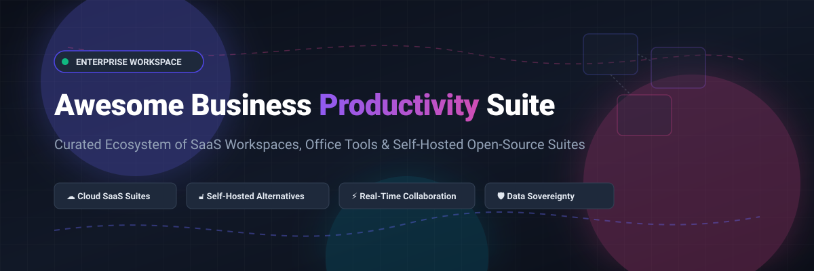

<p align="center">
  
</p>

# 💼 Awesome Business Productivity Software Suite

<p align="center">
  <a href="https://github.com/ishandutta2007/Awesome-Awesome-Awesome"></a><a href="https://discord.gg/jc4xtF58Ve"></a>
  <a href="https://github.com/ishandutta2007/Awesome-Awesome-Awesome"></a>
  <a href="http://creativecommons.org/publicdomain/zero/1.0/"></a>
  <a href="https://github.com/ishandutta2007/Awesome-Business-Productivity-Software-Suite/pulls"></a>
  <a href="https://github.com/ishandutta2007"></a>
</p>

> 🚀 A curated list of leading **Business Productivity Software Suites**, enterprise office platforms, real-time document collaboration systems, and sovereign self-hosted open-source alternatives.

Comprehensive directory comparing top **SaaS productivity suites** (Microsoft 365, Google Workspace, Apple iWork, Lark, Zoho Workplace, WPS Office, Polaris Office, ONLYOFFICE) and **open-source office suites** (AppFlowy, AFFiNE, NocoDB, Outline, Nextcloud, DocuSeal, Etherpad, Grist, CryptPad, ONLYOFFICE, Standard Notes, LibreOffice, HedgeDoc, Collabora Online, Apache OpenOffice, Nextcloud Office). Ideal for IT administrators, startup founders, remote engineering teams, enterprise architects, and self-hosters looking for unified office, document, and collaboration stacks.

---

## 📑 Table of Contents

- [🌐 Overview](#-overview)
- [📈 Sector Overview & Market Dynamics](#-sector-overview--market-dynamics)
- [☁️ SaaS & Hosted Productivity Suites](#️-saas--hosted-productivity-suites)
  - [SaaS Feature, Pricing & Valuation Comparison](#saas-feature-pricing--valuation-comparison)
  - [Detailed SaaS Profiles](#detailed-saas-profiles)
- [🔓 Open-Source & Self-Hosted Office Suites](#-open-source--self-hosted-office-suites)
  - [Open-Source Solutions Ranked by Stars](#open-source-solutions-ranked-by-stars)
  - [Complementary Self-Hosted Ecosystem](#complementary-self-hosted-ecosystem)
- [🏗️ Architecture & Deployment Patterns](#️-architecture--deployment-patterns)
- [🎯 Selection Guide & Decision Matrix](#-selection-guide--decision-matrix)
- [🤝 How to Contribute](#-how-to-contribute)
- [💖 Support](#-support)
- [📜 Disclaimer & License](#-disclaimer--license)
- [⭐  Star Hsstory](#--star-hsstory)

---

## 🌐 Overview

Business productivity suites integrate essential workplace applications—word processing, spreadsheets, presentations, cloud file storage, business email, team chat, calendar scheduling, and video conferencing—into a unified environment.

Key capabilities to look for:
- 🏢 **Unified Workspace**: Single sign-on (SSO), centralized administration, and shared access control.
- 👥 **Real-Time Collaboration**: Multi-user concurrent editing, commenting, and presence indicators.
- 📄 **Interoperability**: High-fidelity support for Microsoft Office formats (`.docx`, `.xlsx`, `.pptx`) and Open Document Format (`.odf`).
- 🛡️ **Data Sovereignty & Privacy**: On-premises hosting options, end-to-end encryption, and regulatory compliance (GDPR, HIPAA, SOC 2).

---

## 📈 Sector Overview & Market Dynamics

The global business productivity software market is estimated at **$79.4B – $104.1B in 2025** and is projected to reach **$98.8B – $110.4B by 2026** (growing at a compound annual growth rate of ~8–12%), accelerated by embedded Generative AI assistants and permanent hybrid workplace structures. 

The sector displays a **bimodal market structure**: it is **heavily concentrated at the foundational tier** as an oligopoly dominated by tech titans (Microsoft and Google controlling the lion's share of enterprise office suites and cloud email), yet **highly fragmented across adjacent layers and point solutions** (e.g., project boards, specialized databases, secure signature workflows, and knowledge bases), where over 30% of enterprises suffer from SaaS sprawl and actively seek unified workspace consolidation.

---

## ☁️ SaaS & Hosted Productivity Suites

### SaaS Feature, Pricing & Valuation Comparison

> Products are sorted in descending order by parent company size (Market Capitalization / Valuation / Revenue).

| Product | Company Size (Market Cap / Valuation / Revenue) | Key Included Apps | Pricing Model (Starting Tier) | Free Tier Limits / Free Trial | Best For |
|:---|:---|:---|:---|:---|:---|
| **[Apple iWork](https://www.apple.com/iwork/)** | **~$3.4 Trillion** Market Cap | Pages, Numbers, Keynote, iCloud Drive | **$0.00** (Free bundled with Apple hardware) | **Free tier forever**: 5GB free iCloud storage per Apple ID; unlimited document creation on Web via iCloud.com | Mac & iOS-centric creative teams, solo professionals |
| **[Microsoft 365](https://www.microsoft.com/en-us/microsoft-365/)** | **~$3.1 Trillion** Market Cap ($245B+ annual revenue) | Word, Excel, PowerPoint, Outlook, OneDrive, Teams, Loop | **$6.00/user/month** (Microsoft 365 Business Basic, annual commitment) | **No business free forever tier**; 30-day free trial (up to 25 seats for Business Standard); basic personal web-only version available at office.com | Enterprise governance, compliance, Active Directory / Entra ID integration |
| **[Google Workspace](https://workspace.google.com/)** | **~$2.1 Trillion** Market Cap (Alphabet) | Gmail, Drive, Docs, Sheets, Slides, Meet, Chat, Calendar | **$6.00/user/month** (Business Starter, 1-year commitment) | **No business free forever tier**; 14-day free trial for business plans with full features; personal Google accounts include 15GB free across Gmail/Drive/Photos | Cloud-native teams, seamless browser-first collaboration |
| **[Lark](https://www.larksuite.com/)** | **~$220 Billion** Valuation (ByteDance) | Lark Docs, Sheets, Base, Chat, Video Meetings, Calendar, Approvals | **$12.00/user/month** (Lark Pro, billed annually) | **Free tier forever**: up to 50 users, 100GB total cloud storage, 60-minute meeting duration limit (up to 50 participants) | Remote-first startups and agile teams aiming to unify chat, video, and documents |
| **[Kingsoft WPS Office](https://www.wps.com/)** | **~$18 Billion** Market Cap (Kingsoft Corp) | Writer, Spreadsheets, Presentation, PDF Editor, Cloud Sync | **$35.99/user/year** (WPS Pro, ~$2.99/month equivalent) | **Free tier forever**: basic editing of docs, spreadsheets, slides, and 1GB cloud storage (ad-supported, advanced PDF export locked) | Lightweight resource footprint and native PDF manipulation |
| **[Zoho Workplace](https://www.zoho.com/workplace/)** | **~$1.4 Billion+** Annual Revenue (Bootstrapped, Private) | Mail, Writer, Sheet, Show, WorkDrive, Cliq, Meeting, Connect | **$3.00/user/month** (Standard plan, billed annually) | **Free tier forever**: Forever Free plan for up to 5 users, 5GB email storage per user, 1 domain, web-only access | Small-to-mid businesses, teams leveraging Zoho CRM or Books |
| **[Polaris Office](https://www.polarisoffice.com/)** | **~$250 Million** Market Cap (Polaris Office Corp, KOSDAQ) | Word, Sheet, Slide, PDF Editor, NOVA AI Agent | **$3.99/user/month** (Pro plan) or **$79.99** one-time lifetime license | **Free tier forever**: Polaris Office Basic with viewing and basic editing, 1GB cloud storage, 60MB/month upload cap (ad-supported) | Users requiring lifetime buyout options and Korean HWP format compatibility |
| **[ONLYOFFICE DocSpace](https://www.onlyoffice.com/)** | **~$25 Million - $50 Million** Estimated Valuation (Ascensio System SIA) | Document Server, Collaboration Rooms, Custom Form Creator | **$15.00/admin/month** (DocSpace Business, annual billing) | **Free tier forever**: DocSpace Startup edition is 100% free with 1 admin, up to 12 collaboration rooms, and 2GB cloud storage | High-fidelity MS Office compatibility and document security |

---

### Detailed SaaS Profiles

#### 🍎 [Apple iWork](https://www.apple.com/iwork/)
Apple's native office suite consisting of Pages, Numbers, and Keynote, with iCloud-based synchronisation across macOS, iPadOS, iOS, and modern web browsers.
- 💡 **Key Differentiator**: High-end typography, fluid vector presentation animations, 3D object insertion, and hardware acceleration on Apple Silicon.
- 🎯 **Ideal Audience**: Design studios, marketing agencies, and creative professionals working primarily within the Apple hardware ecosystem.

#### 🪟 [Microsoft 365](https://www.microsoft.com/en-us/microsoft-365/)
The enterprise benchmark for productivity software, combining desktop and web editions of Word, Excel, PowerPoint, Outlook, OneDrive, Microsoft Teams, and Copilot AI.
- 💡 **Key Differentiator**: Unmatched enterprise identity management (Entra ID), advanced compliance certifications, granular retention policies, and Power Platform automation.
- 🎯 **Ideal Audience**: Mid-size to large enterprises requiring tight Windows integration, legacy VBA/macro support, and strict compliance controls.

#### 🌐 [Google Workspace](https://workspace.google.com/)
Pioneering cloud-native productivity platform providing Gmail, Google Drive, Docs, Sheets, Slides, Google Meet, Google Chat, and Gemini AI.
- 💡 **Key Differentiator**: Frictionless real-time multi-user co-authoring, zero-footprint browser client, and intuitive administration.
- 🎯 **Ideal Audience**: Modern distributed startups, tech companies, and educational institutions prioritizing browser-first speed and collaboration.

#### 🕊️ [Lark](https://www.larksuite.com/)
Next-generation collaboration workspace merging team messaging, high-definition video conferencing, Docs, Sheets, multidimensional database (Base), and workflow automation.
- 💡 **Key Differentiator**: Replaces disjointed tools by embedding spreadsheets and collaborative documents directly into chat conversations and calendar invites.
- 🎯 **Ideal Audience**: Fast-moving startups, remote companies, and hybrid teams aiming to eliminate SaaS app fragmentation.

#### ⚡ [Kingsoft WPS Office](https://www.wps.com/)
All-in-one desktop and mobile office suite bundling Writer, Spreadsheets, Presentation, integrated PDF editor/converter, and AI writing assistants.
- 💡 **Key Differentiator**: Minimal memory footprint, fast launch times, and built-in PDF modification without requiring third-party tools.
- 🎯 **Ideal Audience**: Individual professionals, students, and budget-conscious offices needing an efficient Microsoft Office alternative.

#### 💼 [Zoho Workplace](https://www.zoho.com/workplace/)
Integrated suite bundling Zoho Mail, Writer (docs), Sheet (spreadsheets), Show (presentations), WorkDrive (cloud storage), Cliq (team chat), Meeting (video conferencing), and Connect (social intranet).
- 💡 **Key Differentiator**: Deep integration with Zoho's business apps (convert emails directly into CRM leads or Desk tickets; publish documents straight to WordPress).
- 🎯 **Ideal Audience**: Growing companies seeking a cost-effective, feature-complete alternative to Google Workspace or Microsoft 365.

#### ⭐ [Polaris Office](https://www.polarisoffice.com/)
Cross-platform productivity suite with desktop, web, and mobile support, paired with Polaris Drive and the NOVA AI assistant for document drafting and analysis.
- 💡 **Key Differentiator**: Hybrid pricing options (perpetual lifetime buyout license or subscription) along with native support for Korean HWP format documents.
- 🎯 **Ideal Audience**: Users seeking standalone desktop licensing with modern AI document features.

#### 📄 [ONLYOFFICE DocSpace & Cloud](https://www.onlyoffice.com/)
Collaborative office platform designed around document rooms (collaboration, custom, and public rooms) powered by the core ONLYOFFICE document engine.
- 💡 **Key Differentiator**: 100% native compatibility with Microsoft format specifications (OOXML) and robust security room capabilities.
- 🎯 **Ideal Audience**: Organizations handling confidential agreements and contracts requiring auditable collaboration workflows.

---

## 🔓 Open-Source & Self-Hosted Office Suites

For organizations prioritizing **data sovereignty**, offline resiliency, zero vendor lock-in, and strict privacy regulation compliance (e.g., GDPR, HIPAA), self-hosted open-source software provides complete autonomy over company data.

### Open-Source Solutions Ranked by Stars

> Repositories are sorted in descending order by GitHub stargazer count. Each repository includes a social Stars_Badge linking to its official stargazers page.

1. **[AppFlowy](https://github.com/AppFlowy-IO/AppFlowy)** [](https://github.com/AppFlowy-IO/AppFlowy/stargazers)  
   *Open-source Notion alternative for wikis, notes, tasks, and project tracking.*  
   Built with Flutter and Rust to offer speed, privacy, and full offline-first functionality. Self-hostable via Docker with end-to-end data control.  
   `Tags:` `#notes #wiki #offline-first #flutter #rust`

2. **[AFFiNE](https://github.com/toeverything/AFFiNE)** [](https://github.com/toeverything/AFFiNE/stargazers)  
   *Next-generation visual workspace uniting docs, whiteboards, and database tables in one canvas.*  
   True canvas-first productivity workspace combining the flexibility of Miro with the structure of Notion and Google Docs.  
   `Tags:` `#workspace #canvas #whiteboard #docs #realtime`

3. **[NocoDB](https://github.com/nocodb/nocodb)** [](https://github.com/nocodb/nocodb/stargazers)  
   *Open-source Airtable alternative that turns any relational database into a smart spreadsheet.*  
   Connects directly to MySQL, PostgreSQL, Microsoft SQL Server, and SQLite, enabling visual grids, galleries, kanbans, and automated workflows.  
   `Tags:` `#database #nocode #airtable-alternative #sql #spreadsheet`

4. **[Outline](https://github.com/outline/outline)** [](https://github.com/outline/outline/stargazers)  
   *Fast, collaborative team knowledge base and documentation platform.*  
   Features structured markdown editing, instant search, granular team permissions, and integrations with Slack, Figma, and Google Workspace.  
   `Tags:` `#knowledge-base #wiki #markdown #documentation #collaboration`

5. **[Nextcloud Server](https://github.com/nextcloud/server)** [](https://github.com/nextcloud/server/stargazers)  
   *Turnkey self-hosted content collaboration and productivity hub.*  
   Provides on-premises file sync, sharing, calendar, mail, contacts, and real-time audio/video calls with comprehensive enterprise compliance tools.  
   `Tags:` `#private-cloud #file-storage #self-hosted #enterprise`

6. **[DocuSeal](https://github.com/docusealco/docuseal)** [](https://github.com/docusealco/docuseal/stargazers)  
   *Open-source document signing and digital contract workflow platform.*  
   Self-hosted DocuSign alternative for creating PDF forms, collecting legally binding digital signatures, and automating document signing pipelines.  
   `Tags:` `#digital-signature #pdf #contracts #workflow #docusign-alternative`

7. **[Etherpad](https://github.com/ether/etherpad-lite)** [](https://github.com/ether/etherpad-lite/stargazers)  
   *Real-time collaborative text editor with version playback and plugin ecosystem.*  
   Lightweight, highly responsive editor designed to be integrated or run standalone for concurrent document drafting and collaborative notes.  
   `Tags:` `#realtime #collaborative-editor #nodejs #embeddable`

8. **[Grist](https://github.com/gristlabs/grist-core)** [](https://github.com/gristlabs/grist-core/stargazers)  
   *Relational spreadsheet-database hybrid with full Python formula execution.*  
   Combines the intuitive tabular interface of Excel with the relational integrity and view layouts of a structured database.  
   `Tags:` `#spreadsheet #database #python #self-hosted`

9. **[CryptPad](https://github.com/cryptpad/cryptpad)** [](https://github.com/cryptpad/cryptpad/stargazers)  
   *End-to-end encrypted, zero-knowledge collaborative office suite.*  
   Features encrypted rich text, spreadsheets, presentations, code editors, and kanban boards where the host server has zero visibility into user data.  
   `Tags:` `#zero-knowledge #e2ee #privacy #collaboration`

10. **[HedgeDoc](https://github.com/hedgedoc/hedgedoc)** [](https://github.com/hedgedoc/hedgedoc/stargazers)  
    *Real-time collaborative Markdown editor with interactive presentation slides.*  
    Supports live dual-pane preview, math notation (MathJax), diagrams (Mermaid, PlantUML), and instant slide deck rendering from markdown.  
    `Tags:` `#markdown #slides #mermaid #collaboration #realtime`

11. **[ONLYOFFICE Document Server](https://github.com/ONLYOFFICE/DocumentServer)** [](https://github.com/ONLYOFFICE/DocumentServer/stargazers)  
    *Enterprise-grade self-hosted document editing server (AGPLv3).*  
    Provides seamless browser-based co-authoring for DOCX, XLSX, and PPTX files with 100% Microsoft compatibility. Connects to Nextcloud, ownCloud, and Seafile via API.  
    `Tags:` `#ooxml #office-suite #self-hosted #docker #agpl`

12. **[Standard Notes App](https://github.com/standardnotes/app)** [](https://github.com/standardnotes/app/stargazers)  
    *End-to-end encrypted notes and workspace suite.*  
    A secure sanctuary for thoughts, sensitive credentials, code snippets, and spreadsheets, backed by audited client-side encryption algorithms.  
    `Tags:` `#encrypted #security #privacy #notes #cross-platform`

13. **[LibreOffice Core](https://github.com/LibreOffice/core)** [](https://github.com/LibreOffice/core/stargazers)  
    *The definitive open-source desktop office suite from The Document Foundation.*  
    Bundles Writer, Calc, Impress, Draw, Base, and Math. Standardizes on OpenDocument Format (ODF), runs 100% offline, and enforces zero telemetry.  
    `Tags:` `#desktop #odf #offline #document-foundation #c++`

14. **[Collabora Online](https://github.com/CollaboraOnline/online)** [](https://github.com/CollaboraOnline/online/stargazers)  
    *Browser-based collaborative office engine built upon LibreOffice technology.*  
    Offers real-time co-authoring directly on private servers or Kubernetes clusters, protecting documents from unauthorized cloud data mining.  
    `Tags:` `#libreoffice #wopi #self-hosted #collaborative #docker`

15. **[Apache OpenOffice](https://github.com/apache/openoffice)** [](https://github.com/apache/openoffice/stargazers)  
    *Legacy open-source office suite under the Apache Software Foundation.*  
    Provides stable, non-cloud desktop office applications (Writer, Calc, Impress) for users seeking a lightweight, unchanging interface.  
    `Tags:` `#desktop #apache #legacy #office`

16. **[Nextcloud Office](https://github.com/nextcloud/richdocuments)** [](https://github.com/nextcloud/richdocuments/stargazers)  
    *Collabora Online integration backend for Nextcloud.*  
    Enables embedded document editing and collaborative authoring inside the Nextcloud web interface.  
    `Tags:` `#nextcloud #integration #office #richdocuments`

---

### Complementary Self-Hosted Ecosystem

- 📊 **[Planka](https://github.com/plankanban/planka)** — Real-time kanban tracking board for project management.
- 🔐 **[Vaultwarden](https://github.com/dani-garcia/vaultwarden)** — Lightweight Bitwarden-compatible server in Rust for team credential management.
- 🗃️ **[Paperless-ngx](https://github.com/paperless-ngx/paperless-ngx)** — Community-driven document archiving system with automated OCR and indexing.

---

## 🏗️ Architecture & Deployment Patterns

Build a private, sovereign enterprise productivity stack by assembling modular open-source layers:

```
┌────────────────────────────────────────────────────────┐
│                   Reverse Proxy / TLS                  │
│               (Caddy / Traefik / Nginx)                │
└───────────────────────────┬────────────────────────────┘
                            │
       ┌────────────────────┴────────────────────┐
       ▼                                         ▼
┌──────────────────────────────┐  ┌──────────────────────────────┐
│       File & Identity        │  │       Document Engine        │
│       (Nextcloud Hub)        │◄─┼─► (ONLYOFFICE / Collabora)   │
│  - Storage, Calendar, Mail   │  │  - Headless Office Engine    │
│  - SSO / LDAP / OAuth2       │  │  - WOPI / REST Protocols     │
└──────────────┬───────────────┘  └──────────────────────────────┘
               ▼
┌──────────────────────────────┐
│       Database & Cache       │
│    (PostgreSQL / Redis)      │
└──────────────────────────────┘
```

---

## 🎯 Selection Guide & Decision Matrix

| Requirement | Recommended Solution | Why |
|:---|:---|:---|
| 🏢 **Maximum Enterprise Compatibility** | Microsoft 365 | Seamless integration with corporate Active Directory, Outlook, and Excel macros |
| ⚡ **Simple Web-First Collaboration** | Google Workspace | Fastest real-time multi-user editing with zero client installation |
| 🛡️ **Strict Data Sovereignty & GDPR** | Nextcloud + Collabora / ONLYOFFICE | Full control over physical storage location, database, and encryption keys |
| 🔒 **Zero-Knowledge Confidentiality** | CryptPad | Cryptographically enforced privacy where hosting providers cannot access data |
| 💰 **Cost-Effective Small Business All-in-One** | Zoho Workplace | Complete suite encompassing email, documents, and chat at competitive pricing |
| 💻 **Full Desktop Offline Capability** | LibreOffice | Powerful offline desktop suite with native OpenDocument Format standards |
| 🎨 **Mac-Centric Visual Design** | Apple iWork | Top-tier typography, keynote motion graphics, and zero subscription fee |

---

## 🤝 How to Contribute

Contributions are welcome! Help keep this productivity software directory comprehensive, up-to-date, and useful:

1. 🍴 **Fork** the repository on GitHub.
2. 🔍 Check existing listings to avoid duplicates.
3. 📝 Follow the formatting standard:
   - For SaaS: include product name, URL, summary, differentiator, company size, and specific pricing and free-tier limits in the comparison table.
   - For Open-Source: include repository link, Stars_Badge (`style=social&color=white`), tags, and primary use cases.
4. 🚀 Open a **Pull Request** with a concise description of the addition.

---

## 💖 Support

Thank you for visiting and using this repository! If this curated guide helps you evaluate, deploy, or streamline your business productivity software stack, please consider supporting the project:

- ⭐ **Star** this repository to help others discover it.
- 🍴 **Fork** and contribute new tools, updates, or fixes.
- 📢 **Share** it with fellow developers, IT admins, and entrepreneurs.
- ☕ **Buy me a coffee**: Support ongoing maintenance and open-source curation via the [GitHub Sponsor Dashboard](https://github.com/sponsors/ishandutta2007).

---

## 📜 Disclaimer & License

- This repository is a community-curated compilation and does not constitute a formal endorsement or commercial affiliation.
- All product names, logos, and brands are property of their respective owners.
- Open-source implementations should be audited and deployed following standard security practices (TLS encryption, automated backups, and access policy enforcement).

[](http://creativecommons.org/publicdomain/zero/1.0/)

Distributed under the Creative Commons Zero v1.0 Universal License.

---

##  Star Hsstory
[](https://www.star-history.com/#ishandutta2007/Awesome-Business-Productivity-Software-Suite&type=date&legend=top-left)
